# devops-final

Node.js (Express) app with a full DevOps cycle: Docker, Docker Compose, Prometheus + Grafana
monitoring, GitHub Actions CI/CD (GHCR) and Ansible deployment.

## Application

| Method | Path       | Response                                                    |
|--------|------------|-------------------------------------------------------------|
| GET    | `/`        | `DevOps Final Project` (text)                               |
| GET    | `/health`  | `{ "status": "ok" }`                                        |
| GET    | `/metrics` | Prometheus metrics (`prom-client`): default Node.js metrics + `http_requests_total`, `http_request_duration_seconds` |

```bash
npm ci
npm run lint
npm test
npm start                # http://localhost:3000
```

## Docker / Compose

```bash
docker compose up -d --build
```

| Service    | URL                     | Notes                                           |
|------------|-------------------------|-------------------------------------------------|
| app        | http://localhost:3000   | image `ghcr.io/pantihen/devops-final:latest`    |
| prometheus | http://localhost:9090   | scrapes `app:3000/metrics` every 5s             |
| grafana    | http://localhost:3001   | admin/admin, Prometheus datasource + dashboard provisioned |

## CI/CD (`.github/workflows/ci-cd.yml`)

`lint` → `test` (service `postgres:16-alpine` with `pg_isready` health check) → `build-and-push`
(only on push to `main`; multi-arch image to `ghcr.io/pantihen/devops-final` with tags `latest` and `<commit sha>`).

`main` is protected: merging requires a PR with passing `lint` and `test` checks.

## Ansible (`ansible/deploy.yml`)

Runs on `localhost`: installs Docker (Debian/Ubuntu) if missing, creates `/opt/devops-final`,
copies `docker-compose.yml`, `prometheus.yml` (and Grafana provisioning), runs `docker compose up -d`,
then checks app health, the Prometheus `app` target and Grafana.

```bash
cd ansible
ansible-playbook deploy.yml          # add -K if sudo needs a password
```

Test host used for the demo: a clean Ubuntu 24.04 container without Docker
(`ansible/test-host`), the playbook runs inside it against `localhost`:

```bash
docker build -t devops-final-host ansible/test-host
docker run -d --privileged --ulimit nofile=1024:524288 --name devops-final-host \
  -p 13000:3000 -p 19090:9090 -p 13001:3001 \
  -v devops-final-host-docker:/var/lib/docker -v "$PWD":/workspace:ro devops-final-host
docker exec devops-final-host ansible-playbook deploy.yml   # 1st run: installs Docker, deploys
docker exec devops-final-host ansible-playbook deploy.yml   # 2nd run: changed=0 (idempotent)
```

`--ulimit nofile=1024:524288` is needed only for this container test host: without systemd, Docker is
started by `/etc/init.d/docker`, which runs `ulimit -Hn 524288`. On a real server Docker runs under systemd.

## Screenshots

### Part 1: app, Docker Compose, Prometheus, Grafana
| | |
|---|---|
| `GET /` | 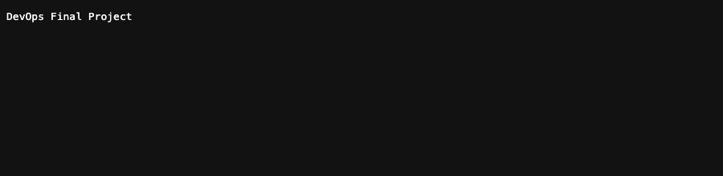 |
| `GET /health` | 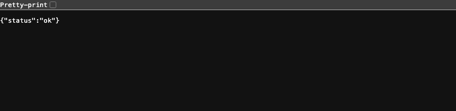 |
| `GET /metrics` | 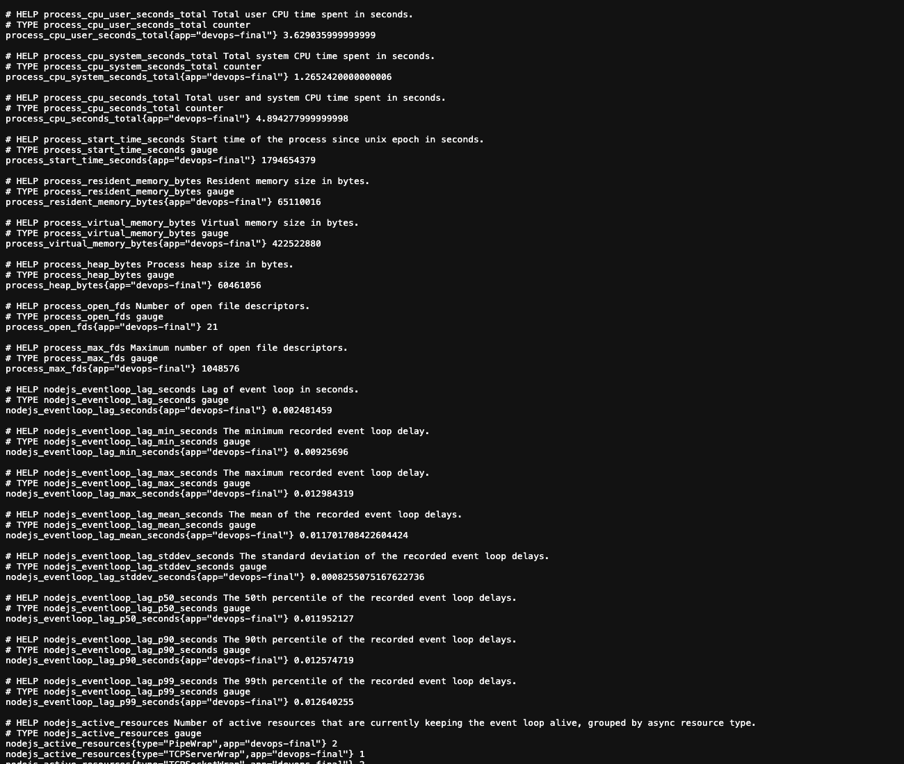 |
| `docker compose ps`, routes, targets, Grafana datasource | 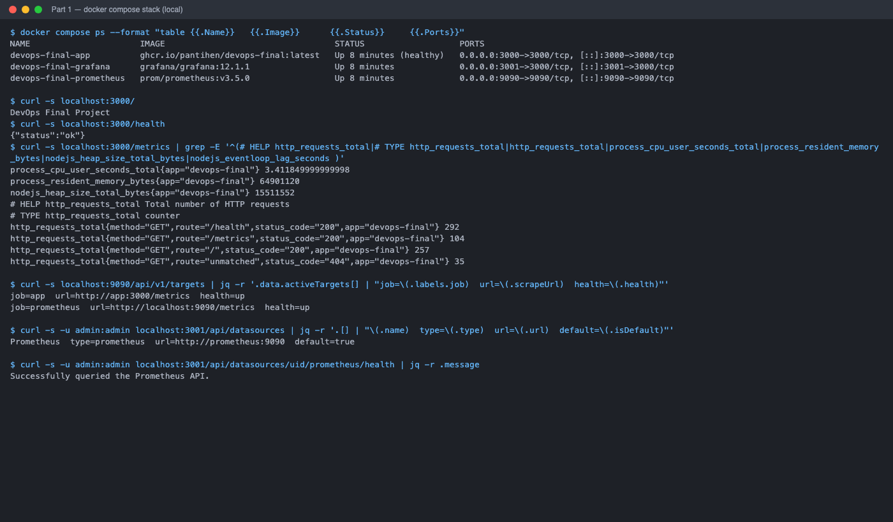 |
| Prometheus: target `app` is **UP** | 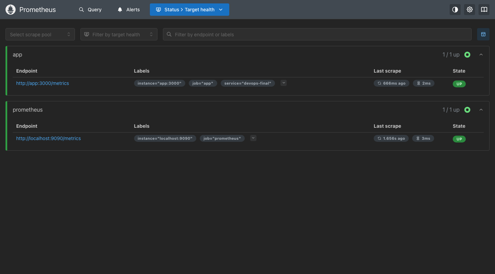 |
| Grafana (:3001) dashboard on the Prometheus datasource | 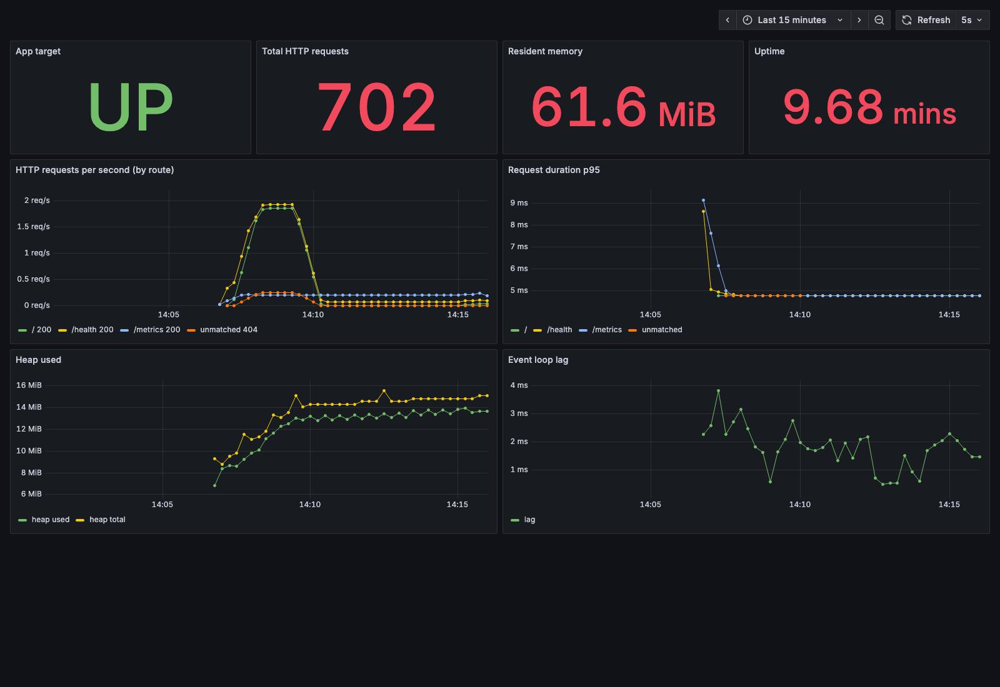 |

### Part 2: CI/CD
| | |
|---|---|
| PR develop → main: `lint` ✓, `test` ✓, `build-and-push` skipped | 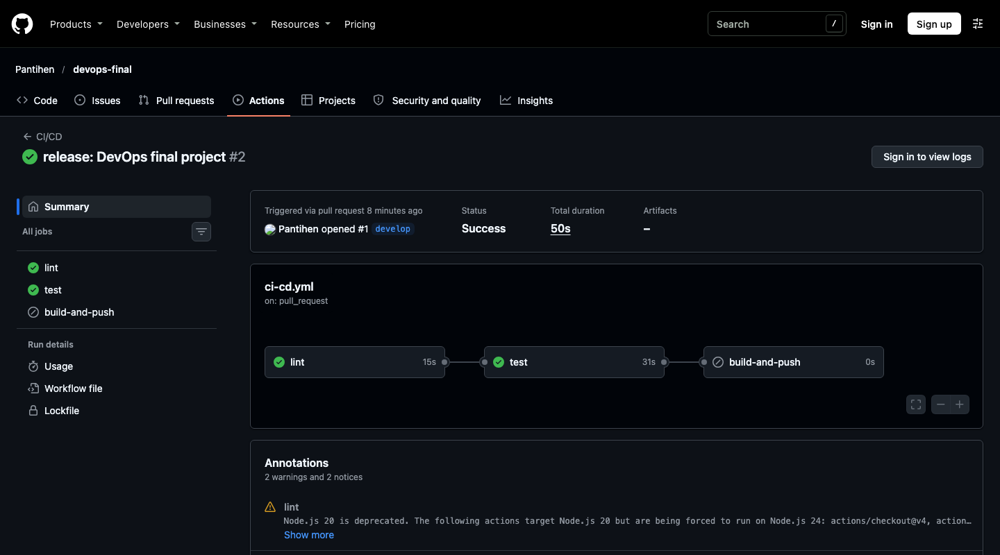 |
| Push to main: `lint` → `test` → `build-and-push` ✓ | 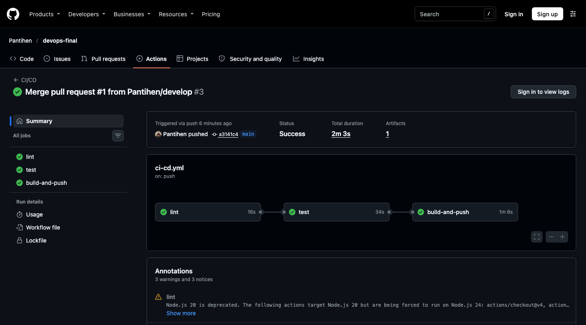 |
| Merged PR | 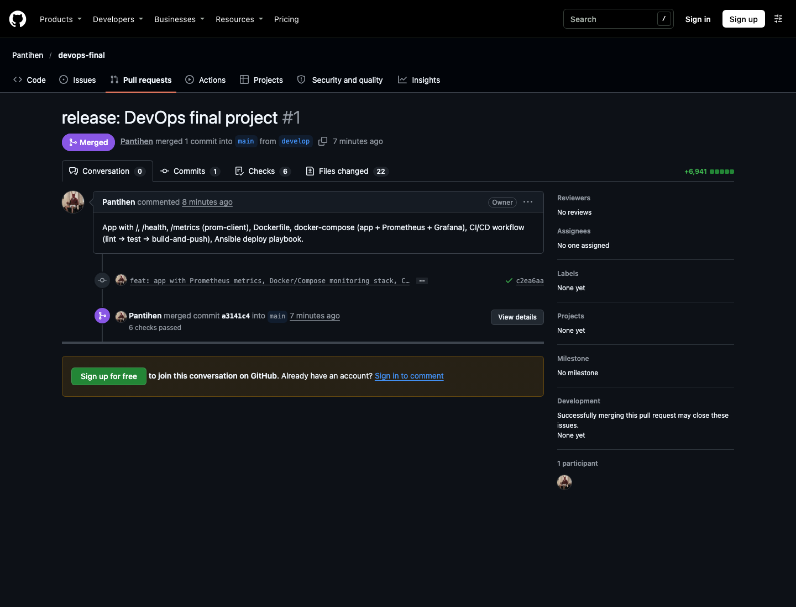 |
| GHCR package: tags `latest` + commit SHA | 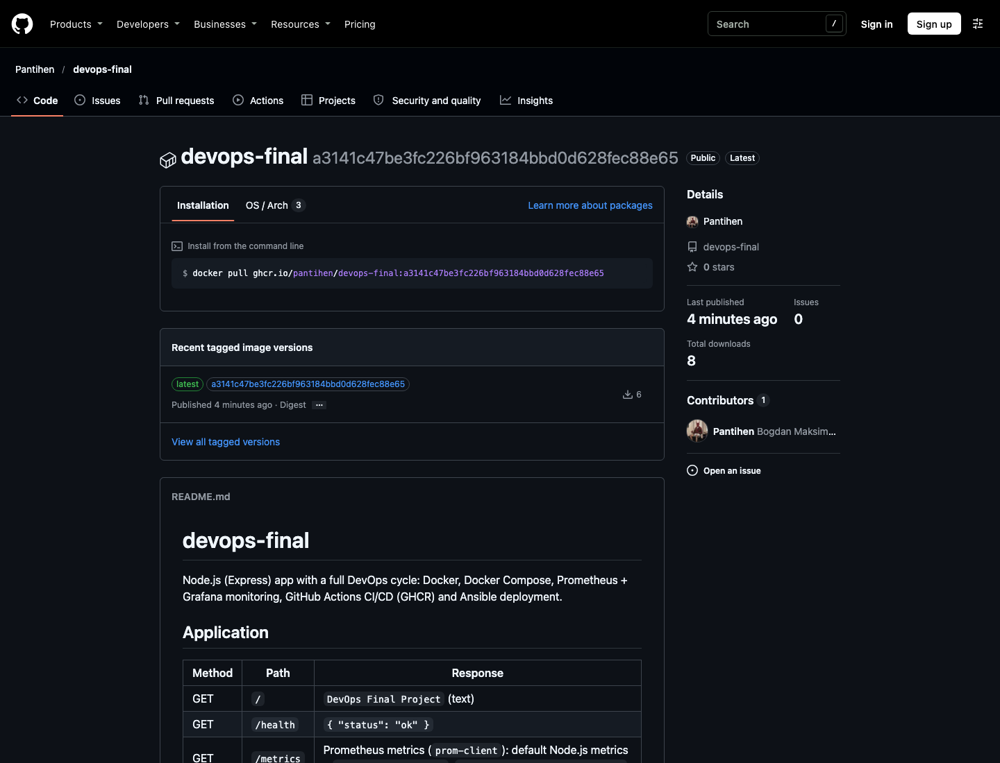 |
| Branch protection, PR checks, run, image tags (CLI) | 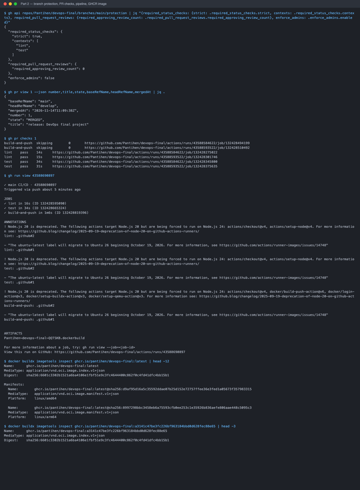 |

### Part 3: Ansible
| | |
|---|---|
| Run 1 on clean Ubuntu (Docker installed, stack deployed): `changed=8 failed=0` | 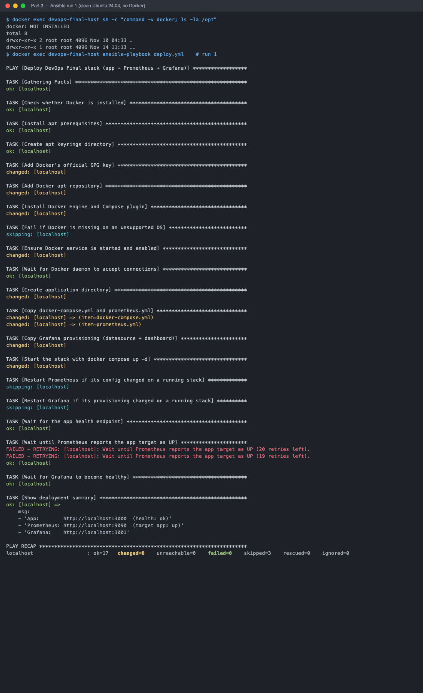 |
| Run 2: `changed=0` (idempotent), stack in `/opt/devops-final` | 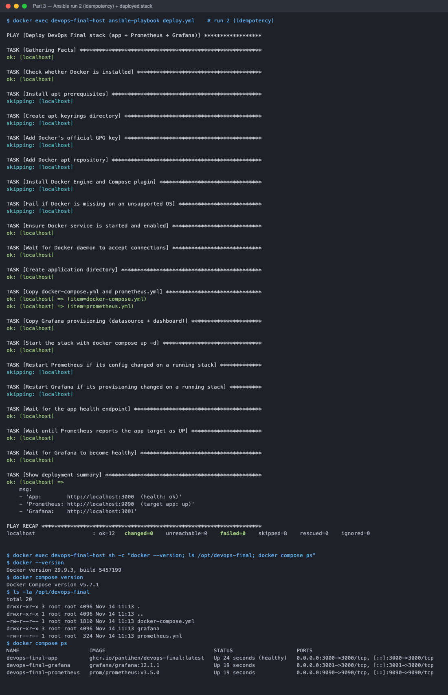 |
| Prometheus on the Ansible-deployed host: `app` UP |  |
| Grafana on the Ansible-deployed host | 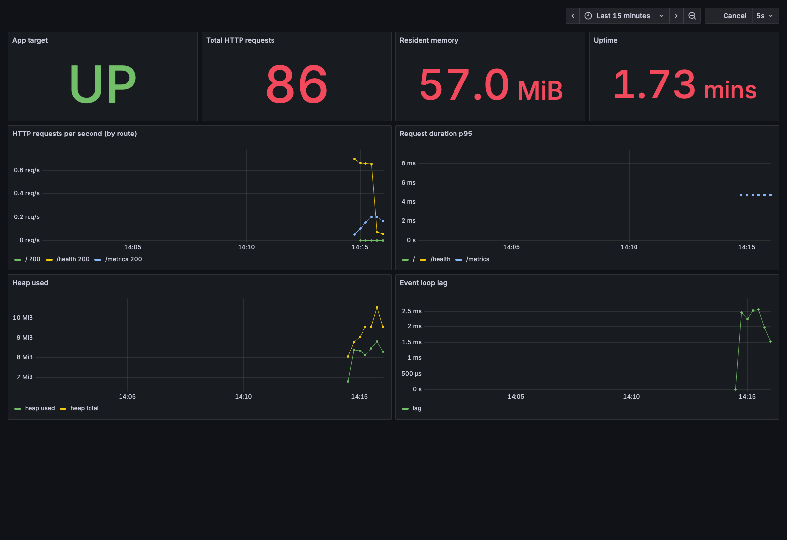 |

Raw command output is in `screenshots/*.log`.
